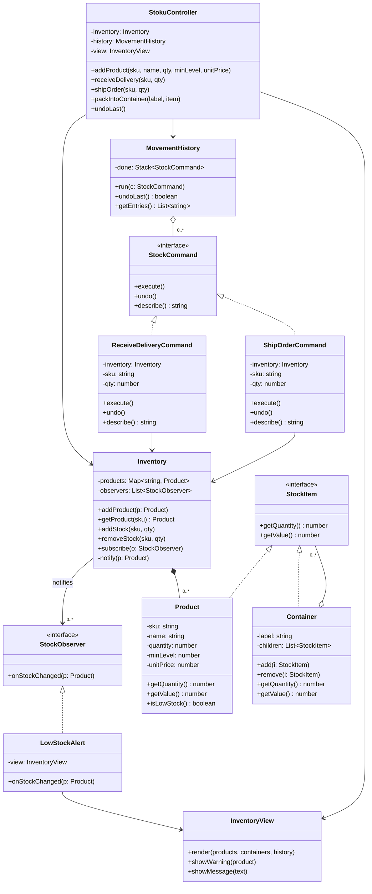

# Stoku – class diagram (draft, planned design)

Owner: Jetik Gjonbalaj · SWEN-383 Part 1

This is the **planned** design we refactor towards during the semester. Version 1 of the code is
deliberately simpler (see `docs/risks.md`): it has no `StockObserver`, no commands and a `Box` that
cannot nest. The three patterns are marked in the notes below the diagram.

## Patterns in the diagram

| Pattern | Classes | Why |
| --- | --- | --- |
| **Composite** | `StockItem` (component), `Product` (leaf), `Container` (composite) | A box holds products, a pallet holds boxes. `getQuantity()` and `getValue()` work the same on one product or a whole pallet, so the rest of the app never asks "is this a box or a product?". |
| **Observer** | `Inventory` (subject), `StockObserver`, `LowStockAlert` | `Inventory` tells every subscribed observer when stock changes. The low-stock check lives in one place, and a new alert (e.g. email) is one new class with no change to `Inventory`. Fixes Risk 1. |
| **Command** | `StockCommand`, `ReceiveDeliveryCommand`, `ShipOrderCommand`, `MovementHistory` | Every stock movement is an object that can `execute()` and `undo()` itself. `MovementHistory` keeps them on a stack, which gives both the history list and undo. Fixes Risk 2. |
| **GRASP Controller** | `StokuController` | Receives every UI event and delegates, so the view has no business logic. Same idea as `TodoController` in the labs. |

## Relationship choices

- **`Inventory *-- Product` is composition.** A product record only exists inside the inventory; if
  the inventory is removed, its products go with it.
- **`Container o-- StockItem` is aggregation.** A product can be taken out of a box and still exist,
  and a box can be taken off a pallet. The parts live on without the container.
- **`MovementHistory o-- StockCommand` is aggregation.** The history holds commands but does not
  create them; the controller creates them and hands them over.
- **Interfaces in JavaScript.** JavaScript has no `interface` keyword, so `StockItem`,
  `StockObserver` and `StockCommand` are base classes whose methods throw `"not implemented"`. The
  UML still shows them as interfaces because that is their design role.
