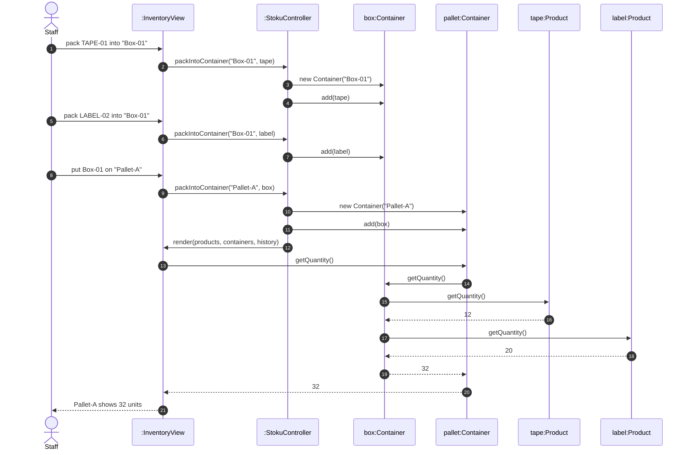

# Sequence diagram – pack products into a box and the box onto a pallet

Owner: Lis Mala · SWEN-383 Part 1

**Scenario.** Staff pack `TAPE-01` (12 in stock) and `LABEL-02` (20 in stock) into a box called
`Box-01`, then put the box on a pallet called `Pallet-A`. The pallet shows 32 units in total.

This flow shows the **Composite** pattern: `Product` and `Container` are both `StockItem`s, so the
same `add()` call packs a product into a box and a box onto a pallet, and `getQuantity()` adds up the
whole tree by itself. Method names match `class-diagram.md`.

## What to notice

- **One method for every kind of packing.** `packIntoContainer(label, item)` takes any `StockItem`,
  so packing a product into a box and a box onto a pallet is the same call. A new `Container` is only
  created the first time a label is used.
- **The view never asks what is inside.** It calls `getQuantity()` on the pallet exactly as it would
  on one product. The pallet asks its children, the box asks its children, and the total comes back
  up. That is the point of Composite.
- **Stock and packing stay in sync.** The box holds the same `Product` objects as the inventory, so
  shipping 5 × TAPE-01 later would make the pallet show 27 without any extra code.
- **In v1 none of this works.** `Box` can only hold products and cannot go on a pallet.
