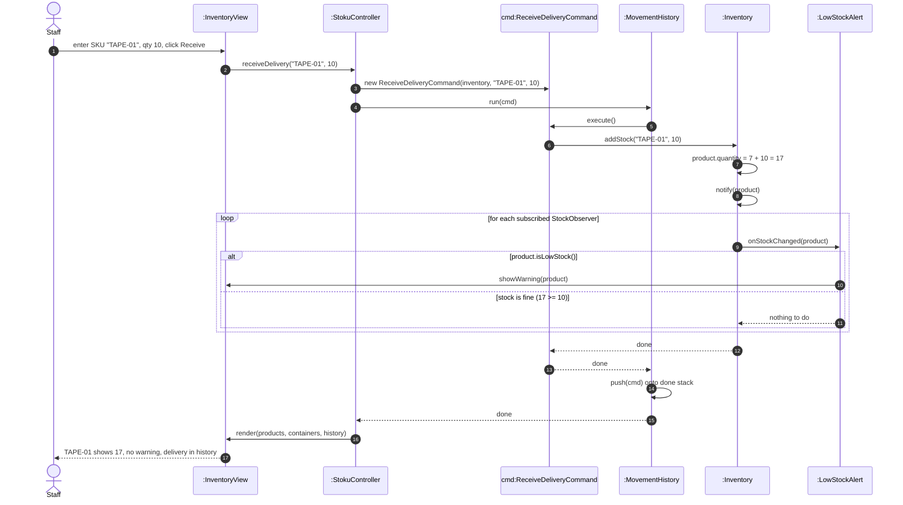

# Sequence diagram – receive a delivery

Owner: Lis Mala · SWEN-383 Part 1

**Scenario.** After the shipment in `seq-ship-order.md`, `TAPE-01` has 7 in stock (minimum 10), so
the low-stock warning is showing. A delivery of 10 rolls arrives. Staff record it, stock goes up to
17, and no warning is shown.

This flow shows **Command** (the delivery is a command run through the history, so it can be undone)
and **Observer** (the inventory notifies its observers, and only `LowStockAlert` decides whether to
warn) when stock goes **up**. Method names match `class-diagram.md`.

## What to notice

- **Same flow as shipping, opposite direction.** The controller builds a command and hands it to
  `MovementHistory.run()`. Only the command class and `addStock` instead of `removeStock` change.
  That is what makes the Command pattern easy to extend.
- **The warning goes away by itself.** `render()` redraws the table from current stock, and
  `LowStockAlert` only warns while `isLowStock()` is true, so no "clear warning" code is needed.
- **The delivery can be undone.** `ReceiveDeliveryCommand.undo()` calls `removeStock("TAPE-01", 10)`,
  and stock would go back to 7 with the warning showing again (see `seq-undo.md`).
