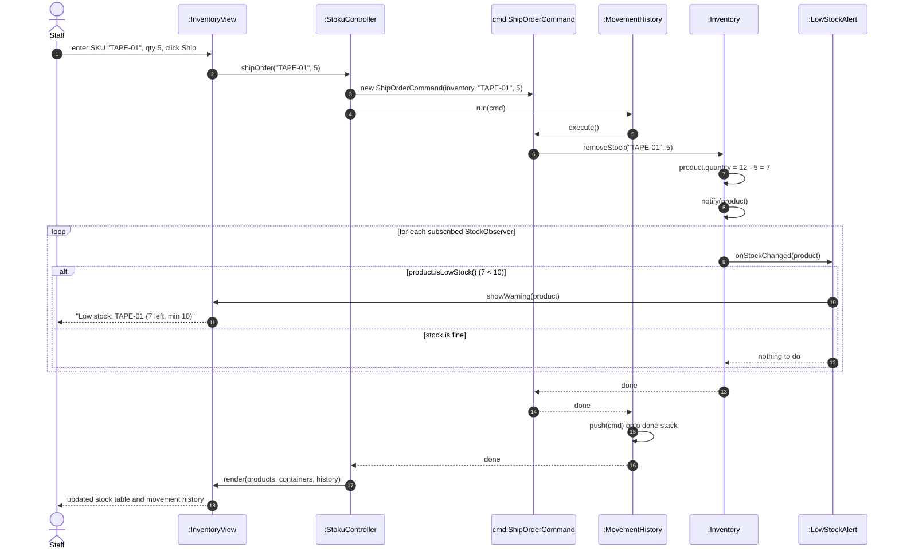

# Sequence diagram – ship an order that drops stock below minimum

Owner: Eris Visoka · SWEN-383 Part 1

**Scenario.** Product `TAPE-01` has 12 in stock and a minimum level of 10. A member of staff ships
an order of 5. Stock drops to 7, which is below the minimum, so a low-stock warning appears.

This one flow shows **Command** (the shipment is a command run through the history) and **Observer**
(the inventory notifies its observers, and only `LowStockAlert` decides whether to warn) working
together. It uses the planned design from `class-diagram.md`; method names match that diagram.

## What to notice

- **`Inventory` never mentions warnings or the view.** It only calls `notify(product)`. Whether a
  warning appears is decided by `LowStockAlert`. In v1 this check is copied into every method that
  changes stock (Risk 1); here it exists once.
- **`StokuController` does not change stock itself.** It builds a `ShipOrderCommand` and hands it to
  `MovementHistory`. Because the command is pushed on the stack after `execute()`, the shipment can
  be undone later (see `seq-undo.md`).
- **If the quantity is too large**, `removeStock` throws an error before anything changes, the
  command is not pushed, and the controller shows the error. That branch is left out to keep the
  diagram readable.
