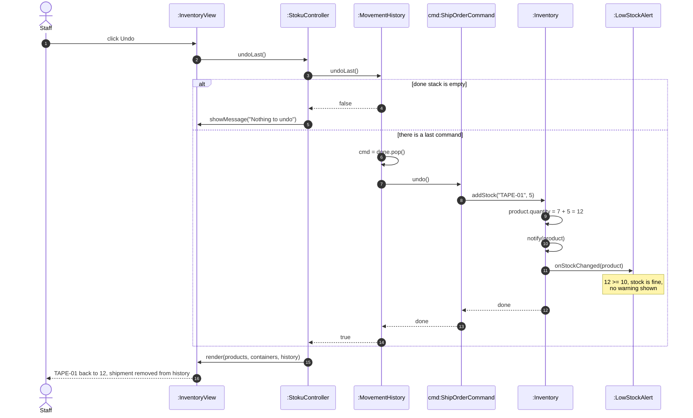

# Sequence diagram – undo the last stock movement

Owner: Mal Gerbeshi · SWEN-383 Part 1

**Scenario.** The last movement was the shipment from `seq-ship-order.md`: 5 × `TAPE-01` shipped,
leaving 7 in stock. It turns out the order was entered by mistake, so staff click **Undo**. The
5 units come back and stock returns to 12.

This flow shows the **Command** pattern: `MovementHistory` does not know what kind of movement it is
undoing. It just pops the last `StockCommand` and calls `undo()`. Method names match
`class-diagram.md`.

## What to notice

- **Undo is the reverse of execute.** `ShipOrderCommand.undo()` calls `addStock`, and
  `ReceiveDeliveryCommand.undo()` calls `removeStock`. Each command stores the `sku` and `qty` it
  needs to reverse itself.
- **`MovementHistory` works with any command.** Adding a new kind of movement later (for example an
  `AdjustStockCommand` for stock counts) needs no change to `MovementHistory` or the controller's
  undo code. That is the Open/Closed Principle in action.
- **Observer still runs during undo.** Undo goes through `Inventory.addStock`, so observers are
  notified as usual. If undoing a delivery dropped stock below the minimum, the warning would
  appear automatically.
- **In v1 none of this is possible** (Risk 2): shipping does `product.quantity -= qty` and writes a
  line of text to `MovementLog`. The text says what happened but cannot reverse it.
